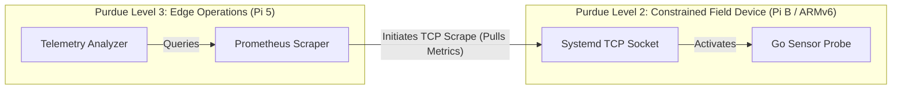

# OT/Edge Architecture & Security testbed 

This project simulates the collection of environmental telemetry on constrained hardware.

It showcases Purdue Model segmentation, secure edge deployments and testing with digital-twin validation.

Current project: a probe to measure both temperature and volume levels.

Note: Since I currently lack the hardware to measure temperature and volume, these readings are simulated for now.

## Architecture

The probe project consists of two halves: a probe and an analyzer.

The probe is deployed as a systemd service running on a Raspberry Pi B, taking (or simulating) measurements and exposing these in Prometheus format on a TCP socket.

> Design note: why Prometheus?  The temperature data is time-series data.
> Prometheus format is a simple time-series format that I'm already familiar with as an SRE.

The analyzer is deployed as a set of containers (podman or k3s), running on a separate Raspberry Pi 5, collecting these measurements and running analysis.
The first container is the Prometheus scraper.
The second will be the analyzer.

> Design note: separating out the analyzer and the probe onto different hardware allows for proper network segmentation between them, and would allow me to scale the temperature probe to multiple rooms without having to duplicate the analyzer.  
> Together with Prometheus' pull model for metrics, this separation also allows us to ensure that all network traffic is initiated by the more trusted Layer 3 node (the analyzer)
> (This separation corresponds to layers 2 (probe) and 3 (analyzer) of the Purdue model)

## Probe

This is a Go [programme](./drivers/measurement/).

This is written in Go because it can be deployed as a single binary, without worrying about interpreters or dependencies.

## Systemd files

There are two [systemd unit files](./systemd/unitFiles/).
These create the socket and service for the probe.

We use socket activation, to avoid wasting work and taking measurements while there's nothing listening.

## Ansible

There is an [ansible playbook](./ansible/) for deploying the probe to the host it runs on (the Raspberry Pi B).

## Testing

The probe is tested in a digital twin - an ARMv6 container.  This allows for testing in a realistic environment, without having to deploy to the hardware before every test.

A real, live probe (as opposed to this testbed) can't tolerate downtime or deployments that might break the probe, so we must test with a simulated twin before deploying.

The [test script](build-test.py) is used to test the deployment of the probe.
It does the following:
1. Build the probe application
2. Create a new [container](Containerfile.rpi), simulating a Raspberry Pi B (running 32-bit, arm v6, running a slimmed down version of Raspbian, including Python and systemd).
3. Run the [ansible playbook](./ansible/) to deploy the probe application properly to the container.
4. Test that it can scrape metrics and receive the correct response.

## Security

These are some of the security features of this testbed.

### Single binary

The probe is written in Go, which compiles to a static binary.
This avoids having any runtime dependencies in the probe, and reduces the attack surface and patch burden.

### Metric pull

By using Prometheus for scraping, we get a pull-based model for scraping metrics.
Connections are initiated from the analyzer to the probe.
This means the more-trusted Level 3 node initiates connections to the Level 2 sensor, and allows us to block outbound connections from the probe (not currently implemented).
In case of a compromise of the probe, this would prevent data exfiltration.
It would also prevent a compromised probe from communicating with a C2 server.

### Systemd hardening

The systemd service file sets `DynamicUser=true` for the real hardware deploy.
This ensures the service runs as a new, ephemeral user, with no privileges on the box beyond what's needed for running the probe.

> NOTE: The service file currently sets `DynamicUser=false` for the digital twin harness.  This is because rootless podman doesn't have the needed permissions for Dynamic User.

### Podman

The test harness uses `podman`, not `docker`, so it can be run in rootless mode.

## Further Security Improvements

There are a few security concerns currently unaddressed by the current architecture.
Some security hardening remains to be implemented.

### Network

I will take advantage of Prometheus' pull model to lock down all outbound connections from the probe, and only allow incoming connections from the analyzer (and only on the metrics port).
I will use the host-based firewall on the device (nftables), configured via Ansible.

### Encryption

Currently, the temperature and volume data is available by any client that requests it, and is sent in plaintext.
I will implement mTLS to provide encryption and to assert that only the Prometheus scraper can request the data.